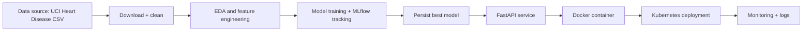

# Heart Disease Prediction MLOps Assignment Report

## 1. Objective

This project develops a production-oriented machine learning pipeline to predict heart disease from patient attributes using a documented, reproducible, and deployable MLOps workflow.

## 2. Dataset and cleaning

The Cleveland Heart Disease dataset from the UCI Machine Learning Repository was downloaded using the script in `scripts/download_data.py`. The raw data contains missing values represented with `?`, which are replaced with `NaN` and removed after type conversion. The binary outcome was transformed so that any value above `0` is treated as the presence of disease.

## 3. EDA summary

EDA focuses on feature distribution, class balance, and inter-feature correlation. The project uses pandas, matplotlib, seaborn, and plotly to produce distribution plots, correlation heatmaps, and class-balance charts. The final dataset is compact, interpretable, and suitable for supervised classification.

## 4. Model development

Two classification pipelines were evaluated:

- Logistic Regression
- Random Forest Classifier

Each model was fit on a stratified train/test split and evaluated using accuracy, precision, recall, and ROC-AUC. The chosen production model is the one with the highest ROC-AUC on the validation split. Cross-validation with a stratified 5-fold split was added to ensure more stable evaluation.

## 5. Experiment tracking

MLflow is enabled in the training workflow. Each model run logs parameters, metrics, and the trained scikit-learn pipeline into the local `mlruns` directory. This creates a reproducible experiment trail that supports model comparison and artifact management.

## 6. Packaging and reproducibility

The model pipeline is saved to `artifacts/best_model.joblib`, and the project includes requirements and a cloned data-download script. The same feature set is used by both training and inference, preserving consistency and allowing reliable deployment.

## 7. CI/CD and testing

The GitHub Actions workflow defined in `.github/workflows/ci.yml` runs dependency installation, dataset download, unit tests, and model training automatically. It fails on any test or training error and uploads the training artifact for workflow inspection.

## 8. Containerization and API serving

The FastAPI application in `app/main.py` exposes `/health` and `/predict` endpoints. The Dockerfile builds a lightweight runtime container and serves the app on port 8000. The API expects patient features in JSON and returns a prediction and risk probability.

## 9. Deployment topology

The Kubernetes manifest in `k8s/deployment.yaml` defines a Deployment and a Service of type `LoadBalancer`. It can be adapted to local Kubernetes clusters such as Docker Desktop Kubernetes or Minikube, and it is a standard template for cloud cluster deployment.

## 10. Monitoring and logging

The FastAPI application logs incoming requests via Python's standard logging module. The runtime is structured for integration with Prometheus and Grafana metrics collection and dashboards.

## 11. Architecture diagram

## 12. Conclusion

This project demonstrates a realistic MLOps workflow: dataset acquisition, reproducible preprocessing, model comparison, trackable experiment history, automated CI/CD, containerization, and deployment-oriented API design. It is suitable as a foundational production project for healthcare prediction systems.
