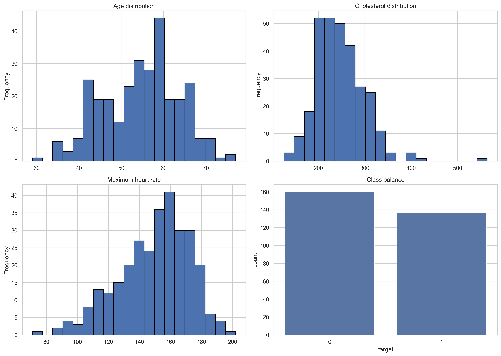
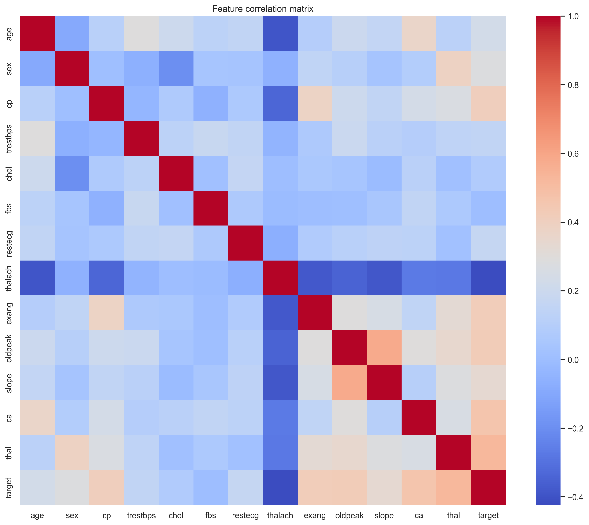
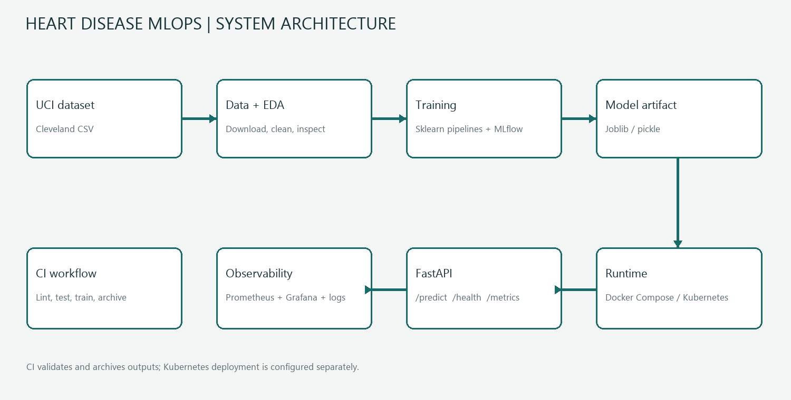
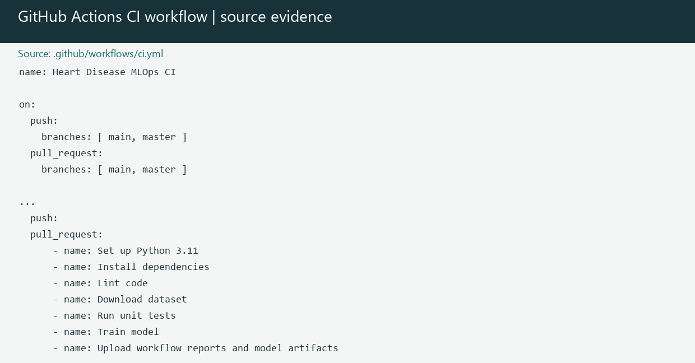
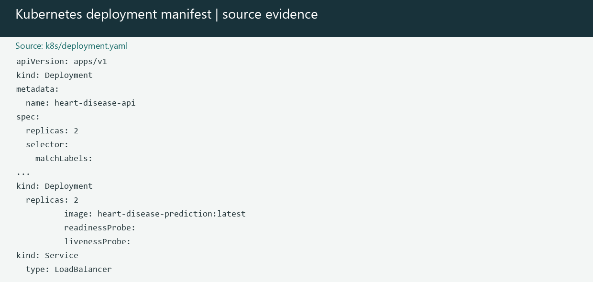

# Heart Disease Prediction MLOps Report

## Project and repository

This project builds an end-to-end classification workflow using the Cleveland Heart Disease dataset. It covers data acquisition and cleaning, exploratory analysis, model evaluation, MLflow tracking, HTTP inference, container packaging, automated CI, and Kubernetes deployment configuration.

**Code repository:** [github.com/arunbaby84/heart_disease_prediction](https://github.com/arunbaby84/heart_disease_prediction)

## Setup and installation

Requirements: Python 3.11 or newer and Git. Docker Desktop is optional for the container stack; a Kubernetes cluster is needed to apply the deployment manifest.

From the repository root, create a virtual environment and install the pinned dependencies. In Windows PowerShell:

```powershell
py -3.12 -m venv .venv
.\.venv\Scripts\python.exe -m pip install --upgrade pip
.\.venv\Scripts\python.exe -m pip install -r requirements.txt
```

On Linux or macOS:

```bash
python3 -m venv .venv
source .venv/bin/activate
python -m pip install --upgrade pip
python -m pip install -r requirements.txt
```

Download and preprocess the data, then train and track the candidate models:

```bash
python scripts/download_data.py
python scripts/preprocess_data.py
python scripts/train_model.py
```

On Windows, use `.venv\Scripts\python.exe` in place of `python` to run each command. The trained pipeline and metrics are written to `artifacts/`; MLflow run data is stored locally in `mlruns/`. Start the API with `python -m uvicorn app.main:app --host 0.0.0.0 --port 8000`; health and prediction endpoints are `/health` and `/predict`.

For the containerized services, run `docker compose up --build`. The Compose stack defines the API, MLflow, Prometheus, and Grafana. The API is available on port 8000, MLflow on 5000, Prometheus on 9090, and Grafana on 3000.

## Dataset and EDA

The downloader reads the Cleveland dataset from the UCI archive. It assigns the 13 input feature names, converts `?` values to missing values, coerces columns to numeric, drops incomplete rows, and binarizes the outcome (`target > 0` becomes 1). The EDA script examines distributions, class balance, pairwise relationships, feature correlations, and IQR outliers. Exported figures are included below and in `docs/screenshots/`.





## Modeling choices and results

The two candidate estimators are Logistic Regression and a class-weighted Random Forest (300 trees, minimum leaf size 2). Both are wrapped in a scikit-learn pipeline with median imputation and standard scaling. A fixed-seed, stratified 80/20 split is used for holdout metrics; five-fold stratified cross-validation on the training partition estimates ROC-AUC stability. Reported metrics below come from the checked-in `artifacts/model_report.json`.

| Model | Holdout accuracy | Precision | Recall | Holdout ROC-AUC | 5-fold ROC-AUC mean (std) |
|---|---:|---:|---:|---:|---:|
| Logistic Regression | 0.833 | 0.846 | 0.786 | **0.950** | 0.869 (0.068) |
| Random Forest | **0.867** | **0.885** | **0.821** | 0.942 | **0.894 (0.059)** |

The current training code selects the model by holdout ROC-AUC, so Logistic Regression is the selected artifact for these recorded metrics. Random Forest has better holdout accuracy, precision, recall, and mean cross-validation ROC-AUC. The dataset is small and the holdout difference is narrow; these results should be treated as an educational evaluation, not evidence of clinical utility. A deployment intended for healthcare decisions would require external validation, calibration, subgroup analysis, and clinical governance.

## Experiment tracking

Training creates one MLflow run per candidate in the `heart_disease_prediction` experiment. It logs estimator parameters, holdout metrics, cross-validation ROC-AUC mean and standard deviation, and the complete fitted scikit-learn pipeline with an inferred input signature. The local tracking store is `mlruns/`; model outputs are also saved as `artifacts/best_model.joblib` and `artifacts/best_model.pkl`, with the metric summary in `artifacts/model_report.json`. Run `python -m mlflow ui --host 127.0.0.1 --port 5000` to browse local runs.

## Architecture

The training and serving paths share the serialized preprocessing-and-model pipeline. The API exposes Prometheus metrics at `/metrics`; Compose provisions Prometheus scraping and Grafana dashboards. Kubernetes configuration provides two API replicas, health probes, and a `LoadBalancer` Service.



## CI/CD and deployment workflow

GitHub Actions runs on pushes and pull requests targeting `main` or `master`. The workflow checks out the repository, configures Python 3.11, installs dependencies, runs Ruff, downloads the data, executes pytest, and trains both candidate models. It uploads logs, test results, artifacts, MLflow runs, and processed data as a workflow artifact. This workflow validates and packages outputs; it does not itself publish a container image or deploy to a cluster.



The Kubernetes manifest in `k8s/deployment.yaml` describes the intended deployment. Apply it to a configured cluster after making the image available to that cluster with `kubectl apply -f k8s/deployment.yaml`. The included manifest alone does not prove a cluster deployment has been performed.



**Evidence note:** The repository contains EDA plots, but no captured GitHub Actions run or live Kubernetes dashboard/cluster screenshots. The two workflow images in this report are clearly labeled renderings of the checked-in configuration, not fabricated UI screenshots. Capture actual run and deployment screens from the target GitHub repository and cluster if live operational evidence is required for submission.

## Generating the PDF

Run `python docs/generate_report.py` from the repository root. The script writes `docs/heart_disease_mlops_report.pdf`, the architecture diagram, and configuration-derived workflow evidence images used by the report.

## API and monitoring

The FastAPI service validates the 13 input fields with a Pydantic request model and returns a binary prediction plus the positive-class probability. `/health` is used by the Kubernetes readiness and liveness probes. Middleware logs request IDs, paths, status codes, and response durations; Prometheus instrumentation exposes request metrics. `docker-compose.yml` defines the local observability stack with Grafana provisioning.

## Reproducibility

Dependencies are pinned in `requirements.txt`; the split and estimators use fixed random seeds. The complete preprocessing and estimator pipeline is persisted, so inference applies the same imputation and scaling as training. Tests can be run with `python -m pytest -q`.
